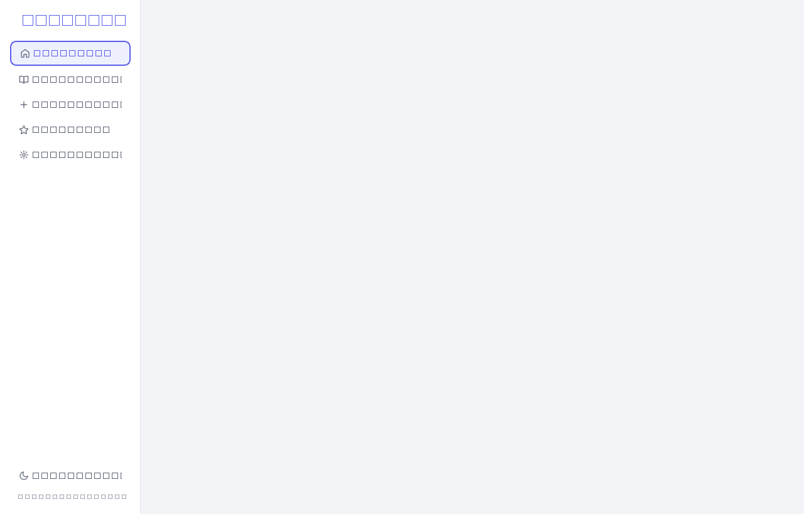
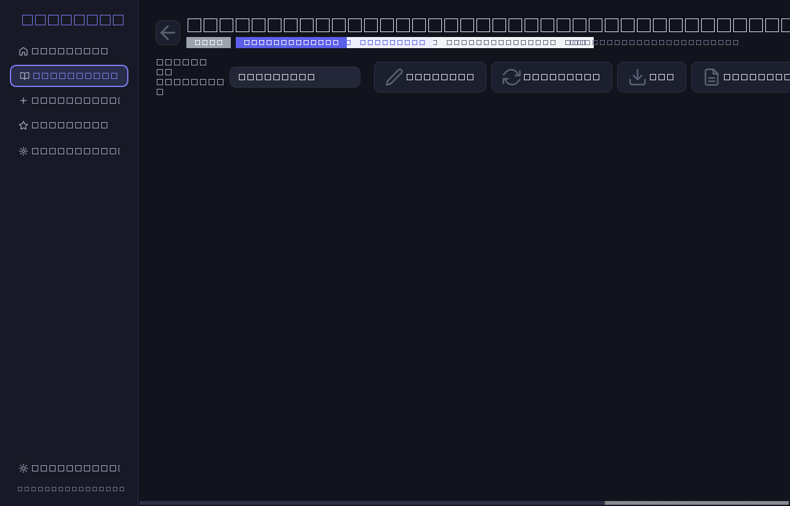

# 🧠 Memora

**Memora** est un logiciel personnel de révision, pensé pour un élève de 3e qui prépare
le brevet. Tu lui donnes un cours (PDF, Word, texte, photo) — il te rend une **fiche de
révision claire, complète et agréable à lire**, rangée dans une bibliothèque locale.

> Importer un cours → comprendre son contenu → produire une excellente fiche de révision
> → la sauvegarder et la retrouver facilement.

| Accueil | Fiche générée (thème sombre) |
|---|---|
|  |  |

---

## ✨ Fonctionnalités

- **Import de cours** : PDF, DOCX, TXT, MD, JPG, JPEG, PNG, WEBP — au clic ou en
  glisser-déposer, avec aperçu du document.
- **Extraction intelligente** : texte intégré des PDF (avec détection automatique des
  PDF scannés), structure des DOCX conservée (titres, listes, tableaux), lecture directe
  des TXT, **OCR** des images et scans via **Mistral OCR** (excellent en français),
  avec repli possible sur Tesseract local.
- **Fiches générées par IA (Mistral)** : objectif, l'essentiel, notions, définitions,
  formules, méthodes, dates/personnages/événements, exemples, pièges, « Si tu ne dois
  retenir que ça » et questions d'auto-évaluation **à réponses masquées**. Les sections
  sont adaptatives : rien de vide, rien d'inventé — les points douteux sont signalés.
- **4 modes de génération** : ⚡ Rapide, 📚 Complète, 🎯 Brevet, 🧠 Active.
- **Bibliothèque locale** : recherche plein texte, filtres (matière, chapitre, statut,
  favoris), tri (récent, ancien, alphabétique), organisation par matière → chapitre.
- **Statuts de révision** : 🔴 À apprendre / 🟡 À revoir / 🟢 Maîtrisée.
- **Favoris**, **modification manuelle complète** (métadonnées + chaque section, ajout /
  retrait de sections), **régénération** depuis le document source.
- **Exports** : PDF mis en page, Markdown, copie presse-papiers, sauvegarde/import de
  toute la bibliothèque (JSON).
- **Thèmes clair / sombre / système**, mode **démonstration** sans clé API, logs locaux.

## 🛠️ Technologies

| Rôle | Choix |
|---|---|
| Langage | Python 3.10+ |
| Interface | PySide6 (Qt 6) — desktop moderne, thèmes QSS |
| Base de données | SQLite (créée automatiquement, zéro configuration) |
| IA | API **Mistral** (`mistral-small-latest` par défaut) : chat + OCR |
| Extraction | PyMuPDF (PDF), python-docx (Word) |
| Sécurité | `keyring` (trousseau système) pour la clé API |

Tout fonctionne **100 % en local** : aucun serveur distant, aucune donnée envoyée ailleurs
qu'à l'API Mistral lors des analyses.

## 📦 Installation (Windows)

1. Installe **Python 3.10 ou plus récent** : https://www.python.org/downloads/
   (coche bien « *Add Python to PATH* »).
2. Télécharge/copie ce dossier, puis **double-clique sur `install.bat`** (une seule fois).
3. Double-clique sur **`run.bat`** pour lancer Memora. C'est tout.

> Sur Linux/macOS : `./run.sh` (crée l'environnement et installe tout automatiquement).

## 🔑 Configuration de la clé API Mistral

L'analyse IA et l'OCR nécessitent une clé **Mistral** (gratuite et suffisant généreuse
pour réviser) :

1. Crée un compte sur <https://console.mistral.ai/> puis génère une **clé API**.
2. Dans Memora : **Paramètres → Intelligence artificielle → Clé API** → colle-la →
   « Enregistrer la clé », puis « **Tester la connexion** ».

Autres méthodes (facultatives) :

- crée un fichier `.env` à côté de `main.py` contenant
  `MISTRAL_API_KEY=ta-cle` (voir `.env.example`) ;
- ou définis la variable d'environnement `MISTRAL_API_KEY`.

La clé est stockée dans le **trousseau de ton système** (Gestionnaire d'identifiants
Windows) — jamais dans le code, jamais affichée en clair, jamais envoyée sur GitHub.

En ligne de commande : `python main.py --check-api` vérifie la clé immédiatement.

## 🚀 Lancement

```bash
python main.py            # lance l'application
python main.py --demo     # ajoute des fiches de démonstration (sans clé API)
python main.py --check-api  # teste la connexion à Mistral
```

Sous Windows, `run.bat` fait tout, tout seul.

## 📂 Structure du projet

```
Memora/
├── main.py                  # point d'entrée (+ options --demo, --check-api)
├── run.bat / install.bat    # lancement et installation Windows
├── memora/
│   ├── config/              # réglages, chemins, stockage sécurisé de la clé
│   ├── core/                # modèle Fiche, SQLite, pipeline de génération, démo
│   ├── extraction/          # PDF, DOCX, TXT, images, OCR (Mistral + Tesseract)
│   ├── ia/                  # client API Mistral, prompts, générateur de fiches
│   ├── export/              # Markdown, HTML, PDF
│   ├── ui/                  # thème, icônes, widgets, vues (accueil, bibliothèque…)
│   └── utils/               # logs, erreurs, fichiers
├── tests/                   # suite pytest (41 tests : extraction, OCR, IA, BDD, UI…)
└── docs/captures/           # captures d'écran
```

## 🔒 Sécurité & données personnelles

- `.env`, la base SQLite, les logs et les exports sont **exclus de git** (`.gitignore`).
- La clé API est masquée dans l'interface (`VlcQ…HPs`) et logguée nulle part.
- Les documents originaux ne sont **pas dupliqués** : la fiche garde une référence
  (chemin) vers le fichier source.
- Les données vivent dans `%APPDATA%\Memora` (Windows) — tu peux les sauvegarder/restaurer
  depuis **Paramètres → Données**.

## ⚙️ Fonctionnement général

1. **Nouvelle fiche** → dépose ton document.
2. Memora **extrait** le contenu (OCR si nécessaire) en affichant la progression
   étape par étape.
3. L'**IA Mistral** analyse le cours et construit la fiche (JSON structuré, validé
   puis mis en forme).
4. La fiche est **enregistrée** dans la bibliothèque : lis-la, modifie-la, marque-la
   favorite, change son statut, exporte-la.

## 🧪 Tests

```bash
python -m pytest tests/ -q
```

41 tests couvrent l'import PDF/DOCX/image, l'OCR, le client API (clé invalide, quota,
réseau, JSON invalide), la génération complète, la base SQLite, les filtres/recherche,
les exports et le démarrage de l'interface.

---

Memora a été conçu pour être utilisé immédiatement : installe, colle ta clé, importe ton
premier cours — et révise. Bonne préparation du brevet ! 🎓
